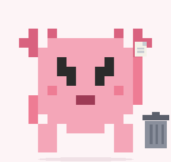

# Pitch — Axolotl Companion: a community mascot plugin for OpenCode 🦎

> Goal: **showcase**, not a core feature request. Two prior "built-in mascot" issues
> (#16557, #26745) were closed as not planned; the plugin system is the supported path.

## Where to post (recommended order)

1. **GitHub Discussion** — `anomalyco/opencode` has Discussions disabled, so we opened issue #65746 upstream and seeded our own [Show and tell](https://github.com/Architect-Brad/axolotl-companion/discussions/1) thread.
2. **r/opencode** (Reddit) — `[Showcase] I built a pixel axolotl that follows my coding agent`.
3. **Hacker News** — Show HN: Axolotl Companion — a 15 MB pixel buddy that follows your coding agent.
4. **OpenCode Discord** — `#showcase` / `#plugins` (check channel rules or ask a mod before self-promo).
5. Only after there is traction: open/revive a **docs plugin-listing PR** so others can discover it.

Stagger them (Reddit → HN → Discord, a day apart) and cross-link from the repo. Posting all
three at once looks like spam; each audience wants a different tone (drafts below).

Do **not** file another "make this the official mascot" feature request. Same idea was
closed twice upstream; the pitch is "here is a working plugin, try it".

## Short post (GitHub / Reddit)

**Title:** `[SHOWCASE] Axolotl Companion — a pixel axolotl that follows your coding agent (OpenCode + Claude Code)`

**Body:**

---

I built a tiny pixel axolotl that reacts to what my coding agent is doing. It started as
a web toy and is now a real plugin package for OpenCode v2 (server + TUI parts) and a
Claude Code hook.

- **34 moods**, including pass/fail reactions: green checks on passing tests, a snapped
  hammer and smoke on failures, sleeping after 60s of quiet.
- **38 agent-aware scenes** — read, grep, edit, test, build, lint, install, delete,
  web fetch, commit, and more. Commands map to scenes via 177 pond-themed verbs.
- **Three faces**: web page (GIF export, collection, seasonal outfits), a truecolor
  terminal pane, and an OpenCode TUI sidebar sprite + `/pet` panel.
- **Brutally small**: run the page and pane in one process with `node server.js --term` —
  **15 MB RSS / 1.2% CPU** idle. The plugin itself uses ~5 MB heap and ~2 µs/event.
- **Actually tested**: 90+ unit tests plus an end-to-end test that drives the real
  OpenCode CLI with a fake model. Exported GIFs are verified by two independent
  decoders (our own LZW implementation + ffmpeg).

Install: `opencode plugin add github:Architect-Brad/axolotl-companion` (or add the repo to
`plugins` in `opencode.jsonc`), then start `node server.js` and open
<http://127.0.0.1:4827>.

No core changes, no telemetry, localhost only, every asset MIT. Happy to answer questions!

*moo — wait, gill-giggle.* 🦎

---

## Venue-ready drafts

### r/opencode (Reddit)

**Title:** `[Showcase] Axolotl Companion — a pixel axolotl that follows your coding agent`

**Body:**

I built a tiny pixel axolotl that reacts to what my agent is doing. It started as a web toy and
is now an OpenCode v2 plugin package (server part + TUI sidebar sprite + `/pet` panel) and a
Claude Code hook.

- 34 moods, 38 tool-aware scenes — passing tests get green checks, failures get a snapped
  hammer and smoke, quiet sessions fall asleep
- four colour morphs, seasonal outfits, a collection, in-page GIF export
- the companion page and terminal pane can run in one process: **~15 MB RSS / 1.2% CPU idle**
- 90+ tests, a real-CLI e2e against OpenCode v2.3.0, GIFs verified by two independent decoders

Install: `opencode plugin add github:Architect-Brad/axolotl-companion`

[Repo](https://github.com/Architect-Brad/axolotl-companion) ·
[Showcase with every GIF/screenshot](https://github.com/Architect-Brad/axolotl-companion/blob/master/SHOWCASE.md) ·
[Release v1.2.0](https://github.com/Architect-Brad/axolotl-companion/releases/tag/v1.2.0)

Not official, not affiliated — just a plugin I wanted to exist. MIT, local only, no telemetry.
Which colour morph should be next? 🦎

---

### Show HN

**Title:** `Show HN: Axolotl Companion – a 15 MB pixel buddy that follows your coding agent`

**Body:**

I built a small pixel companion that watches tool executions and swaps moods: a failing test
gets a snapped hammer and smoke, a passing test gets green checks, a quiet session naps. It's
an OpenCode v2 plugin package (server + TUI parts), a Claude Code hook, a local web page and a
truecolor terminal pane.

A few technical bits I enjoyed building:

- The TUI sprite data is **generated from the terminal renderer**, so the page, pane and
  sidebar cannot drift apart.
- The hand-rolled GIF exporter is checked by **two independent decoders** (our own LZW and
  ffmpeg). That caught a code-width off-by-one that a self-consistent test missed.
- The suite includes a real-CLI e2e: fake model → OpenCode → plugin → companion.
- Running the page and pane in one process costs **~15 MB RSS / 1.2% CPU idle**; the plugin
  itself uses ~5 MB heap and microseconds per event.

[GIF of tool reactions](https://raw.githubusercontent.com/Architect-Brad/axolotl-companion/master/exports/axolotl-tools.gif)
(HN doesn't inline remote GIFs in submission text.)
[Repo](https://github.com/Architect-Brad/axolotl-companion) ·
[Showcase](https://github.com/Architect-Brad/axolotl-companion/blob/master/SHOWCASE.md) ·
[Release](https://github.com/Architect-Brad/axolotl-companion/releases/tag/v1.2.0)

MIT licensed, localhost only, no telemetry. Not affiliated with OpenCode. Happy to answer
technical questions.

---

### OpenCode Discord

> Check channel rules / ask a mod before posting in `#showcase` or `#plugins`.

Hey! I built a pixel axolotl that follows what the agent is doing (reading, tests, builds,
fails, commits, naps) — it's an OpenCode v2 plugin with a sidebar sprite and `/pet` panel.

[GIF](https://raw.githubusercontent.com/Architect-Brad/axolotl-companion/master/exports/axolotl.gif) ·
[Repo](https://github.com/Architect-Brad/axolotl-companion) ·
[Showcase](https://github.com/Architect-Brad/axolotl-companion/blob/master/SHOWCASE.md)

`opencode plugin add github:Architect-Brad/axolotl-companion`

Not official, MIT, local only. Happy to hear feedback or see your screenshots! 🦎

---

## Media to attach

- [Showcase page](SHOWCASE.md) — all GIFs, screenshots, sprite sheets and terminal captures
- `exports/axolotl.gif` — GitHub renders GIFs inline
- `exports/axolotl-tools.gif` — tool reactions
- `exports/axolotl-side.gif` — side-profile animations
- `previews/terminal-showcase.png` — six terminal moods captured from the real ANSI renderer
- `exports/axolotl-front-sheet.png` — all front moods at a glance

## Pre-post checklist

- [x] Push the repo to GitHub under the account you want credited (`Architect-Brad`)
- [x] Attach GIFs, MP4s, sprite sheets and terminal screenshots to the release
- [ ] Confirm `opencode plugin add github:...` works on a normal machine (couldn't verify in this container — OpenCode's service startup needs `lsof`)
- [ ] Post to r/opencode, then HN a day later, then Discord (if allowed)
- [ ] Stay around for the first hour after each post to answer questions

## Why not "official mascot"?

- #16557 (built-in mascot editor) — closed as not planned
- #26745 (built-in buddy system) — closed as not planned
- `opencode-buddy` and `skwid138/opencode-tui` already occupy the plugin space
- The docs explicitly support `opencode plugin add github:...` and `./tui` package parts

Official branding is a maintainer decision earned through adoption. This post is the
first step: people installing and *using* the plugin.
