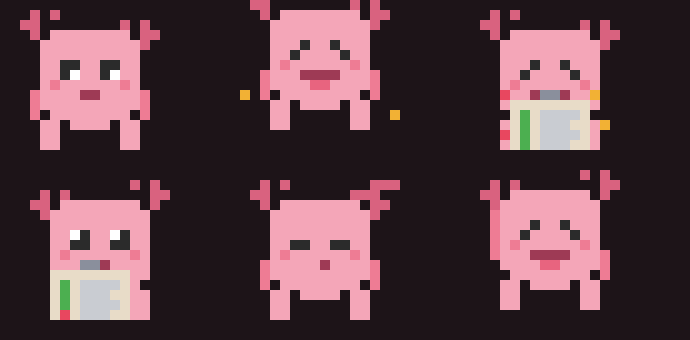

# 🦎 Axolotl companion

A pixel axolotl that follows what your coding agent is doing: thinking, reading, grepping, editing, running tests (and passing or failing them), installing, deleting files, waiting for you. It works with **Claude Code** and **OpenCode**, runs entirely on your machine, and has three faces: a web page, a terminal pane and (Claude Code only) a status-line face.

**[SHOWCASE.md](SHOWCASE.md) — GIFs, screenshots, sprite sheets, terminal captures and release assets.**

## Quick start (about two minutes)

You need Node 18 or newer. There is nothing to install for normal use.

1. **Start the companion:** `node server.js` and open <http://127.0.0.1:4827>, then press **Live**.
2. **Connect your agent** (pick one, or `--all` for both):
   - OpenCode (recommended): `opencode plugin add github:Architect-Brad/axolotl-companion` — installs the package with both its server part (event forwarding) and TUI part (sidebar sprite + `/pet` panel). Or add `"plugins": ["github:Architect-Brad/axolotl-companion"]` to `opencode.jsonc`.
   - OpenCode (single-file install): `node setup.js install --opencode`
   - Claude Code: `node setup.js install --statusline`
   - Add `--project` to `setup.js` for the current project only, `--dry-run` to preview. Restart the agent afterwards.
3. **Optional terminal pane:** `node axo-term.js` in a split pane (`--small`, `--color golden|wild|melanoid`, `--demo`). For the smallest footprint, skip the second process entirely: start the server with `node server.js --term` and it hosts the pane itself (one Node runtime: ~15 MB instead of ~25 MB server + ~45 MB pane; ~1.2% CPU instead of ~1.9%). Standalone mode keeps its own pane/terminal and supports all the flags; embedded mode uses the server's port and default colors.
4. Use your agent normally. `node setup.js status [--opencode]` tells you what is installed and whether the server is running.

Remove everything with `node setup.js uninstall` (add `--opencode` or `--all`). It only removes what it added.

## What's in the box

| Path | What it is |
|---|---|
| `index.html` | The axolotl page (served by `server.js`; also works as a plain file for the toys, but **Live** needs the server). |
| `server.js` | Local-only server: receives events, serves the page, streams scenes to the page and terminal. |
| `mapper.js`, `verbs.json` | The rules that turn tools and commands into scenes, and 177 pond-themed verbs. |
| `setup.js` | Safe installer for both tools (backup, merge, dry run, status, uninstall). |
| `hook.js` | The Claude Code hook command. |
| `opencode/axolotl.js` | The OpenCode server part (one file), also synced to `src/server.ts` for the package. |
| `src/tui.tsx` | OpenCode TUI part: sidebar sprite + `/pet` panel, generated from `axo-term.js` by `npm run gen:tui`. |
| `PITCH.md` | Ready-to-post community-plugin pitch (GitHub / Reddit / HN). |
| `axo-term.js`, `axo-status.js` | Terminal pane and Claude Code status-line face. |
| `tests/` | 90 checks plus an end-to-end test against the real OpenCode CLI. |
| `exports/` | GIFs and sprite sheets of the animations. `previews/` has terminal screenshots. |

## How activity becomes scenes

| What the agent does | Scene |
|---|---|
| You send a prompt | thinking |
| read / grep / glob | reading / grepping / searching |
| edit, write | side-profile coding / typing |
| web fetch | the bucket and well; web search and other tools swim |
| to-do list update | the test checklist |
| sub-agent | waving |
| shell command | by command: `rm` delete, `git commit` save, `git revert` undo, `mv` rename, `npm install` install, `curl`/`git clone` fetch, linters lint, `grep`/`rg` grep, `ls`/`find` search, `cat` read, anything else run |
| test or build finishes | **pass**: green checks or a green check over the anvil. **fail**: a red X and a sweating axolotl, or a snapped hammer and smoke |
| a tool fails | surprised |
| agent finishes | happy for four seconds |
| needs your attention / permission | surprised |
| quiet for 8 s / 60 s | wandering / napping |

Pass or fail comes from the exit code when there is one, otherwise from telltale text (`2 failed`, uppercase `FAIL`, `AssertionError`, `npm ERR!`, `error TS1234`). `0 failed` is a pass. Unclear counts as a pass.

## OpenCode notes

- `setup.js install --opencode` copies one file to `~/.config/opencode/plugins/axolotl.js` (or `.opencode/plugins/` with `--project`). Use `--legacy-dir` for older releases that look in `plugin/`. Restart OpenCode.
- It uses OpenCode's `tool.execute.before/after` hooks and event stream, and also speaks the newer `setup()` hook API. Whichever the running OpenCode supports takes over, so nothing is reported twice.
- Environment: `AXO_PORT` (port, must match the server) and `AXO_DEBUG=/path/file` (log every event the plugin sends).
- OpenCode has no status-line command, so use the terminal pane there.

## Privacy

- Everything stays on your machine. The server listens on 127.0.0.1 only and rejects other Host headers.
- Events carry tool names and short snippets (a command, a file name, a pattern, a URL host). Start the server with `AXO_REDACT=1` to drop the snippets.
- The latest event is saved to `~/.axolotl/state.json` for the status line. Delete that folder to clear it.
- Any local process can post to the port, so don't run it on a shared machine you don't trust.

## In the page

34 moods (front and side profile), a stage with 38 scenes, a task box (`excuse`, `fortune`, `eulogy <name>`, or just type what the axolotl is doing), four real axolotl colours, accessories, optional sound, **Save GIF**, a Collection of everything you've found, and seasonal outfits (add `?date=2026-12-31` to preview a date). There is a story with a secret in it. Tap the axolotl five times.

## Tests

- `npm test`: command rules, the installer (in a throwaway home folder), the OpenCode plugin (fake OpenCode) and the page (headless). Run `npm install` once for the page suite (it uses jsdom); it skips itself if missing.
- `npm run test:opencode`: drives the **real** OpenCode CLI with a fake model through the plugin into the companion. Needs `opencode` on your PATH; skips itself otherwise.

## Honest limits

- Tested against the real OpenCode CLI (1.19.6) with a fake model, and against Claude Code's documented hook format with simulated events. **Not yet tried in a live Claude Code session.**
- OpenCode's newer plugin hook API (`setup()` with hooks) is implemented from its documentation and unit-tested with a fake, but I could not test it against a runtime that has it.
- The tests check logic, not looks; the page, Save GIF and sound have not been checked in a real browser. Windows is untested.
