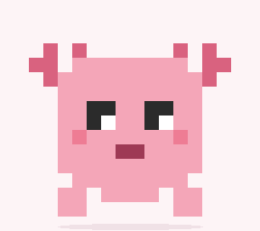
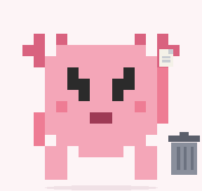
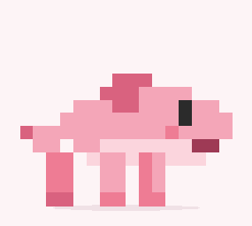
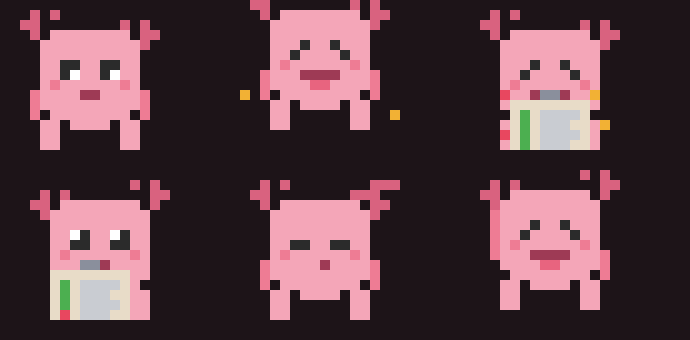
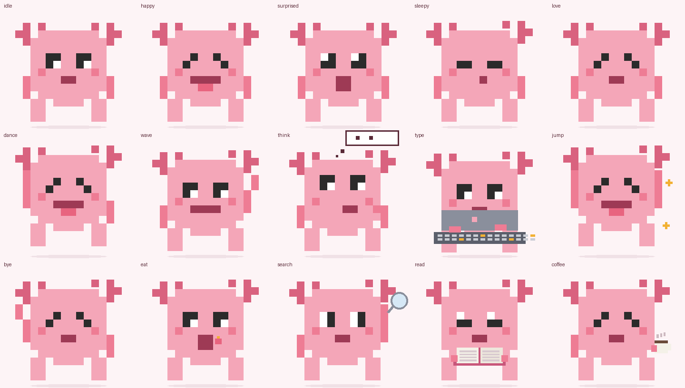
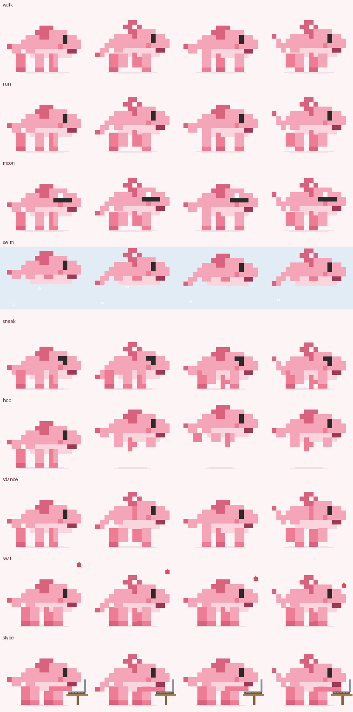
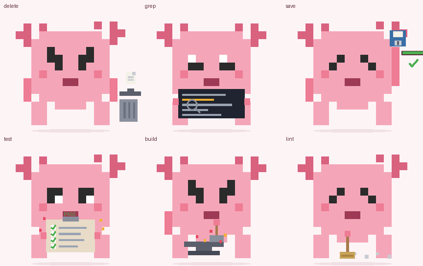
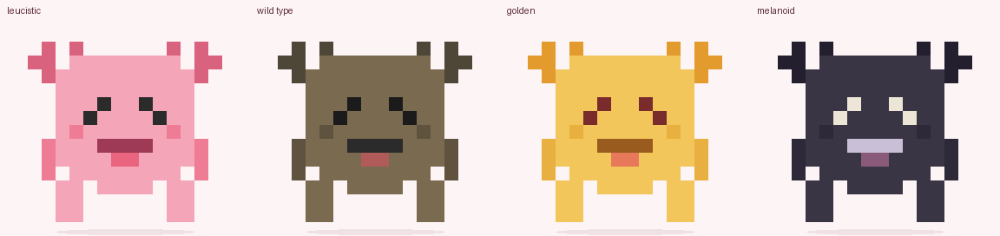

# 🦎 Axolotl Companion — showcase

A pixel axolotl that follows your coding agent. Everything below is rendered from the real
sprite data and ANSI output in this repo — no mockups.

## The mascot

| | |
|---|---|
| Front moods | 34, including idle, happy, surprised, sleepy, love, dance, thinking |
| Agent scenes | 38 — read, grep, edit, test, build, lint, install, delete, fetch, commit… |
| Colour morphs | leucistic, wild, golden, melanoid |
| Reviews | 177 pond-themed verbs |

## Tool reactions

Pass/fail is read from exit codes or output text. Passing tests get green checks; failures get
a red X, sweating, or a snapped hammer and smoke.

[Watch as MP4](exports/axolotl-tools.mp4)

## Side profile

Walk, run, swim, sneak, hop, boogie, code and munch — generated by a side-view animation engine.

[Watch as MP4](exports/axolotl-side.mp4)

## Terminal pane

Six moods captured from `node axo-term.js --once <mood>` and rendered to PNG by
`tools/render_term_png.py`:

| Mood | Screenshot |
|---|---|
| Idle | `previews/terminal-idle.png` |
| Happy | `previews/terminal-happy.png` |
| Test pass | `previews/terminal-testpass.png` |
| Test fail | `previews/terminal-testfail.png` |
| Sleepy | `previews/terminal-sleepy.png` |
| Dance | `previews/terminal-dance.png` |

## Sprite sheets

| Front moods | Side profile | Tool scenes |
|---|---|---|
|  |  |  |

## OpenCode integration

- **Server part** (`.`) — `tool.execute.before/after` hooks plus v2 event subscriptions forward
  activity to the local companion.
- **TUI part** (`./tui`) — animated `sidebar.footer` sprite, `/pet` command and a full-size pet panel.
- **Embedded terminal pane** — `node server.js --term` hosts the pane in the server process:
  ~15 MB RSS / 1.2% CPU idle instead of ~25 MB + ~45 MB for two Node processes.

Install: `opencode plugin add github:Architect-Brad/axolotl-companion`

## Verification

- 90+ unit tests
- Real-CLI e2e against OpenCode v2.3.0 with a fake model
- GIFs decoded by two independent implementations (custom LZW + ffmpeg)
- 232 terminal renders across 29 moods × 4 morphs × 2 display modes
- TUI sprite data generated from `axo-term.js` — no hand-copied art

MIT licensed. Local only. No telemetry.
